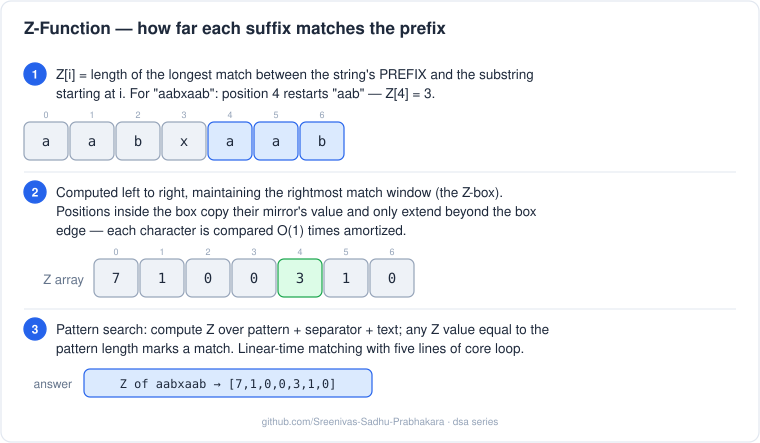

# Z-Function

> Striver SDE Sheet 098 · Day 16 String II — z[i] = how far a prefix re-appears at i; a maintained [l, r) match window recycles earlier answers for linearity. Go, stdlib only, tested.

## Problem

Compute, for every position i of a string, the length of the longest substring starting there that equals a prefix of the string — the Z-array — and use it for pattern search.

## Approach

Maintain the rightmost known prefix-match window [l, r). For a new i inside it, position i mirrors position i−l of the prefix, so `z[i]` starts at `min(z[i−l], r−i)` instead of zero — that seeding is the whole algorithm; a plain loop then extends the match and possibly advances the window. Every character comparison either succeeds (and r only ever moves right, n times total) or fails (once per i), hence O(n). Searching is a one-liner on top: Z of `pattern + sep + text` — with a separator that can't occur in either — marks matches wherever z equals the pattern length. Z is KMP's twin; one measures prefixes forward, the other borders backward.

**Complexity:** O(n) time, O(n) space.

## Visual walkthrough

Read the picture top to bottom — each numbered frame is one moment of the algorithm
running on this repo's test example.

## Run

    go test ./...   # verify
    go run .        # demo

---

One of 191 repos solving Striver's SDE Sheet in Go — stdlib only, one problem per repo, every solution tested. Browse the set: [`dsa-*` repos](https://github.com/Sreenivas-Sadhu-Prabhakara?tab=repositories&q=dsa-&type=source).
